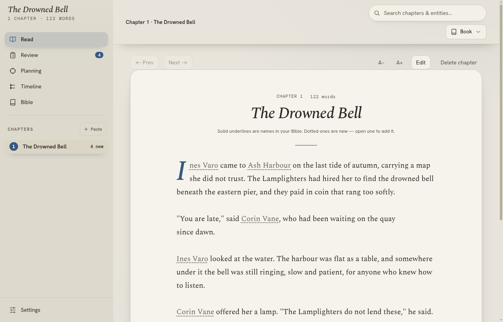
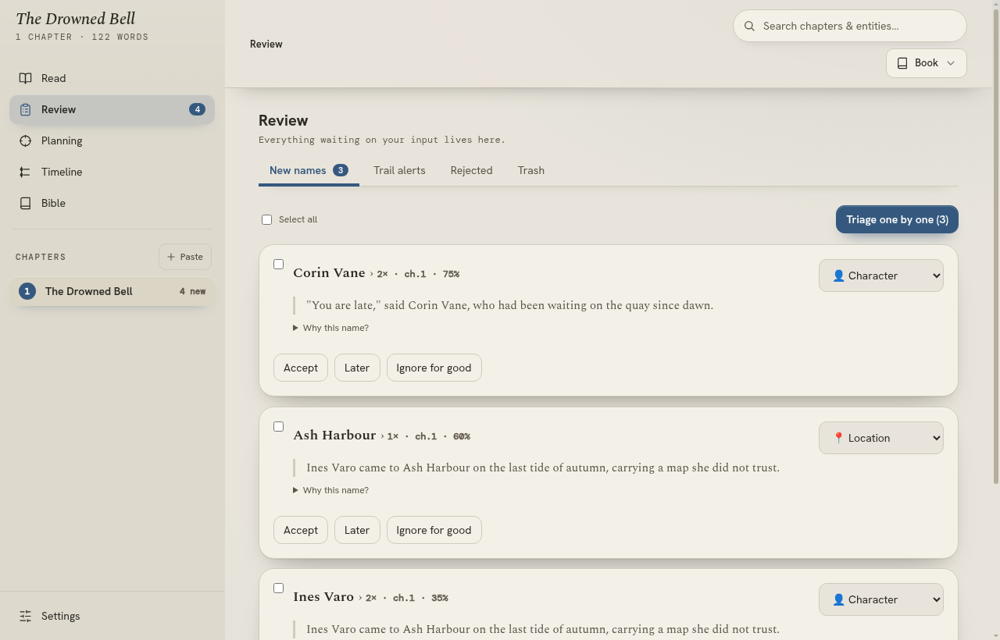

# DocWriter

A writing app for novelists/worldbuilders. You keep writing in Word (or anywhere) and
**paste one chapter at a time**. The app stores the text as a linked viewer, scans it for
names, and triages them into a typed, cross-linked **worldbible**. It gets quieter the
more you use it: once a name is known, future mentions are linked silently.



## Download and install

DocWriter ships for Windows and Linux (x64). Take the latest from
[Releases](https://github.com/Rjbanti420/docwriter/releases).

**Windows — installer:** run `DocWriter-1.1.0-win-x64.exe`. It is not code-signed, so
Windows shows "Windows protected your PC" the first time: **More info → Run anyway**. If you
would rather not run an installer, the `-win-x64.zip` unpacks to a folder with
`DocWriter.exe` in it.

**AppImage — no install:**

```bash
chmod +x DocWriter-1.1.0.AppImage
./DocWriter-1.1.0.AppImage
```

**.deb — installs a launcher entry (Debian/Ubuntu):**

```bash
sudo apt install ./docwriter_1.1.0_amd64.deb
```

Everything runs on your machine: no account, no network calls, no telemetry. `SHA256SUMS.txt`
on the release covers every download — `certutil -hashfile DocWriter-1.1.0-win-x64.exe SHA256`
on Windows, `sha256sum -c` on Linux.

**Your book is one file.** First launch gives you an empty book at
`~/.config/DocWriter/docwriter.db`. *Book → New book…* starts another, *Book → Open book…*
switches to any file, and *Book → Export book file (.db)* writes a copy you can carry to
another computer. A snapshot is saved automatically once a day into `backups/` beside the
book (the last five are kept), so a lost file is not a lost book. Settings → Export writes
Markdown for readers. The About dialog shows which file is open.

New to the app? On an empty page, **Try a sample chapter** loads a short scene, detects its
names and opens triage — the whole loop in one click.

### Known limits

- Windows builds are unsigned, so SmartScreen warns once (see above). There is no macOS
  build yet, and no auto-update — each release is a fresh download.
- The AppImage needs FUSE; `--appimage-extract-and-run` works without it, and the `.deb` avoids
  the question entirely.

## Stack

- **Backend:** Node + Express + built-in `node:sqlite` (no native deps). API on `:5178`.
- **Frontend:** React + TypeScript + Vite. Dev server on `:5173`, proxies `/api`.
- **Data:** `data/docwriter.db` (one SQLite file per book). Delete the `data/` folder to reset.

## Run

```bash
npm install
npm run dev      # starts API + web together
```

Then open http://localhost:5173 — a demo chapter is pre-loaded so you can see the loop.

Other scripts: `npm run build` (production bundle), `npm start` (serve the built app + API
from `:5178` alone), `npm run dist` (Linux AppImage).

Releases: push a `v*` tag and `.github/workflows/release.yml` runs the tests on Linux and
Windows, builds the AppImage, the `.deb`, the Windows installer and the portable zip, and
attaches them plus a `SHA256SUMS.txt` to a draft GitHub release. Building the `.deb` on Arch
locally needs `libxcrypt-compat` for electron-builder's bundled `fpm`; the AppImage builds
everywhere. `npm run dist` builds the AppImage only, and the Windows targets need Windows
(or Wine).

Set `DOCWRITER_DB=/path/to/copy.db` to point the server at another project file (used by the
tests so they never touch your real data).

## The loop

```
PASTE a chapter → store revision → detect candidates
  ├─ new name?  → triage (Accept / Later / Ignore)
  │                Accept  → Entity + Mentions created
  │                Later   → Review › New names
  │                Ignore  → silent forever ("Ignore for good", restorable from Rejected)
  ├─ known name? → auto-link, add Mention (silent)
  └─ tracked trails → Review › Trail alerts (reappeared / dormant)
```

- **One entity per name.** First appearance creates the card; later appearances just add
  mentions. No duplicates.
- **Look-alikes are always asked.** A candidate close to an existing name (`Kaelen` vs
  `Kael`) shows a "same thing / different" prompt. "Same thing" stores it as an alias.
- **Triage is keyboard-first:** `Enter` accept, `1–9` accept as type, `←/→` change type,
  `L` later, `X` ignore, `Esc` close.
- **Review** is one inbox with four tabs: *New names*, *Trail alerts*, *Rejected*, *Trash*.
- **Tracking** is opt-in per entity: `off` / `reappearance` / `absence`, each with a manual
  required gap threshold.
- **Delete chapter** cascades its mentions/scans/alerts and asks keep-gap vs renumber. A card
  that loses its only appearance is moved to **Trash**, not destroyed (recoverable).



## Cutting the noise

Capitalised common words ("Then", "Rain", "Hearing") used to flood triage. Two filters now
keep the queue short:

1. **Dictionary filter.** A bundled ~275k-word English list suppresses words that are plainly
   common (with simple inflections and contractions, so "looking"/"didn't" are caught). It is
   used as a *demotion* signal, never a hard drop, so a real name that is also a word
   (`Grace`, `Rose`) is never lost.
2. **Signal gating.** A candidate is only *primary* if it has a real reason to be a name:
   dialogue attribution (`Kael said` / `said Kael`), a type keyword (`Order`, `River`), an
   unusual non-dictionary token, or enough repetition. Weak candidates are **demoted** and
   hidden behind **"Show more low-confidence"** — still one click away, so nothing is buried
   completely.

Names are ranked by confidence, primary first. Punctuation breaks name groups, so
`"Nodding, Ash said"` correctly links `Ash` rather than inventing "Nodding Ash".

**Rejected** lists everything you've ignored, with a *Restore* button if you change your mind.
**Trash** lists cards orphaned by chapter deletion, with *Restore* and *Delete forever*.

## What's implemented (first slice)

Paste → detect → triage → typed entities + mentions, the reader with colored underlines
for known entities and dotted underlines for un-triaged names, Review inbox (New names /
Trail alerts / Rejected / Trash), precision-first detection with dictionary + signal tiers,
trail alerts, entity cards (type, summary, aliases, tracking, threshold), editable chapter
text with rescan, chapter delete with gap/renumber and orphan-to-Trash, manual entity creation.

## Deferred / not yet built

- Semantic detection of "same name, **different** thing" (a person and a city both named
  `Raven`). Only typo/variant look-alikes are prompted today; add a manual "split mention
  into a new entity" action.
- Undo (the `Z` key) for triage decisions.
- Type-specific custom fields in the UI (schema `fields` JSON exists, no editor yet).
- Relationship/link editing and graph views (the `Link` seam isn't wired yet).
- Global find-and-replace back into Word.

## License

MIT — see [LICENSE](LICENSE).
